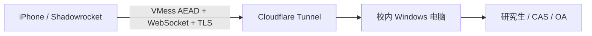

# 吉林大学校园网外网访问_Shadowrocket

让 iPhone 上的 Shadowrocket 经一台在线的校内 Windows 电脑访问吉林大学研究生、选课、就业等系统。无需电脑公网 IP，无需设置路由器端口映射。

默认允许以下9个具体域名：

| 域名 | 入口 |
| --- | --- |
| `yjs.jlu.edu.cn` | 研究生系统 |
| `cas.jlu.edu.cn` | 统一身份认证 |
| `oa.jlu.edu.cn` | OA |
| `yjsxk.jlu.edu.cn` | 研究生选课 |
| `jdjyw.jlu.edu.cn` | 就业相关入口 |
| `jlupy.jlu.edu.cn` | 指定校内系统入口 |
| `www.jlu.edu.cn` | 吉林大学主页 |
| `i.jlu.edu.cn` | 校园门户 |
| `cwsf.jlu.edu.cn` | 缴费入口 `/WF_PAYMENT/` |

**前提：校内电脑本身必须能打开目标网站。** 这是“校内电脑中转”方案，不能把一台无法访问校园内网的普通校外电脑变成校园网。



当前版本基于已完成手机登录验证的结构整理，独立生成每位使用者的密钥，不包含作者的订阅、Cookie、证书或私有运行环境。不使用 WebVPN Cookie，不对学校网站 HTTPS 解密，也不需要安装测试 CA。

## 需要准备什么

- 一台能直接打开研究生系统、CAS、OA 的 **Windows 10/11 x64** 电脑；使用期间保持在线、连接校内网络。
- Python **3.10 或更新版本**；本程序只用标准库，不需要 `pip install`。
- Windows 自带的 `curl.exe`。下载工具时需要能访问 GitHub Releases。
- iPhone 已安装 Shadowrocket。
- 同意使用 Cloudflare 中转。Cloudflare 可以看到连接 IP、时间和流量大小等元数据；学校网页使用原站 HTTPS，VMess 也启用 AEAD 加密。运行时生成的订阅链接本身包含访问令牌，应作为私有凭据保存。

工具固定为 sing-box 1.14.4、cloudflared 2026.10.3；下载地址和官方 SHA-256 在 [tools.lock.json](tools.lock.json)，程序会校验后再使用，不自动安装服务或修改防火墙。

## 让 Codex 或其他 Agent 帮你部署

复制[Agent 自动部署提示词](docs/agent-install-prompt.md)中的完整内容，填写部署目录，交给能操作你校内 Windows 电脑的 Codex 或其他 Agent。提示词包含环境检查、工具校验、启动、完整链路验证和手机导入指导；不包含任何作者的个人凭据。仅能访问云端容器的 Agent 无法直接部署到你的校内电脑。

## 快速部署：临时入口

### 1. 下载项目

有 Git 时，在 PowerShell 中执行：

```powershell
git clone https://github.com/Simon727/JLU-Shadowrocket.git
cd JLU-Shadowrocket
```

没有 Git 时，点击仓库页面 **Code → Download ZIP**，解压后进入项目文件夹打开 PowerShell。

### 2. 下载并校验中转工具

```powershell
py -3 -B .\jlu_shadowrocket.py setup
```

如果电脑只有 `python` 命令，将下文的 `py -3` 换成你的 Python 命令。自定义环境可使用 `start.ps1 -PythonPath <python.exe路径>`。

如 GitHub 下载失败，可为**工具下载**指定已有 HTTP 代理，端口换成自己的实际值：

```powershell
py -3 -B .\jlu_shadowrocket.py setup --download-proxy http://127.0.0.1:7890
```

`setup` 只在本项目的 `tools/` 下载文件，并在 `private/` 生成自己的配置和独立密钥；不会使用仓库作者的节点。

### 3. 启动中转

```powershell
py -3 -B .\jlu_shadowrocket.py start
```

保持这个窗口打开。启动后会显示两条私有链接：

- `Subscription`：Shadowrocket 节点订阅。
- `Config`：只让指定学校域名走该节点的分流配置。

链接同时保存在 `private/links.json`。**不要把它们、二维码或 private 文件夹发到公开仓库、Issue 或截图中。**

Quick Tunnel 不需要 Cloudflare 账号或自己的域名，但入口每次重建可能改变，停止进程后失效，没有可用性保证。长期使用见 [固定域名部署](docs/fixed-tunnel.md)。[Cloudflare 官方说明](https://developers.cloudflare.com/tunnel/get-started/quick-tunnels/)

### 4. 手机导入

1. Shadowrocket 首页点右上角 **＋**，类型选 **Subscribe**，粘贴 `Subscription` 链接并保存。
2. 展开新增订阅，选中 **JLU-Campus** 节点。
3. 底部 **配置 → ＋**，粘贴 `Config` 链接，下载后点击文件，选择 **使用配置**。
4. 回到首页，**全局路由选择“配置”**，开启 VPN。
5. 用 Safari 打开 [研究生系统](https://yjs.jlu.edu.cn/gsapp/sys/yjsemaphome/portal/index.do) 或 [OA](https://oa.jlu.edu.cn/defaultroot/login.jsp)。

CAS 统一身份认证页面属于学校业务系统的正常登录流程。网络连通不会代替学校账号认证；主动点击“退出登录”后，下一次可能需要重新认证。

不要用“全局代理”作为日常模式：服务端只允许配置中的学校域名，其他目标会被拒绝，可能使微信等应用无法联网。

### 5. 验证完整链路

保持启动窗口运行，另开一个 PowerShell：

```powershell
py -3 -B .\jlu_shadowrocket.py check
```

它会实际经过公网 TLS、VMess 和校内电脑请求配置中允许的所有站点，跟随认证跳转、校验 HTTPS 证书，并确认非学校目标被拒绝。结果只保存在 `private/check-result.json`，不执行登录和业务操作。

验证预期：各入口最终返回 `200`，`other_domain_rejected: true`。研究生入口会跳转 CAS 登录页；`yjsxk.jlu.edu.cn` 目前由网站重定向到同域 HTTP 页面，因此检查允许跟随 HTTP/HTTPS 跳转，并报告 `final_scheme`，不会把 HTTP 页面表述为原站全程 HTTPS。这证明入口的访问链路可用，不代表已替你登录。

检查也会报告 `bytes` 和 `empty_response_hosts`。例如 `jlupy.jlu.edu.cn` 的根目录当前可能返回200但无页面内容，此时只能确认响应可达；使用者仍需正确的业务入口路径。HTTP200不等同于业务登录、全部脚本和功能均已验证。

**TCP 显示毫秒数只证明手机能连到入口。** 网页是否能打开还要看完整链路与手机分流日志。[排障指南](docs/troubleshooting.md)

## 合并到自己的日常配置

保留已导入的 `JLU-Campus` 节点。在你的日常配置中点击 **编辑纯文本**，将以下规则放在 `[Rule]` 部分顶部，位于国内直连、GEOIP 和兜底规则之前：

```ini
DOMAIN,yjs.jlu.edu.cn,JLU-Campus
DOMAIN,cas.jlu.edu.cn,JLU-Campus
DOMAIN,oa.jlu.edu.cn,JLU-Campus
DOMAIN,yjsxk.jlu.edu.cn,JLU-Campus
DOMAIN,jdjyw.jlu.edu.cn,JLU-Campus
DOMAIN,jlupy.jlu.edu.cn,JLU-Campus
DOMAIN,www.jlu.edu.cn,JLU-Campus
DOMAIN,i.jlu.edu.cn,JLU-Campus
DOMAIN,cwsf.jlu.edu.cn,JLU-Campus
```

保存并使用该配置，全局路由保持“配置”。规则明确指定校园节点，其他网站继续走原有规则。如果你修改了 `node_name`，这里也要同步修改。

## 配置和停止

首次执行 `setup` 或 `init` 会把 [config.example.json](config.example.json) 复制为 `private/config.json`。在私有配置中调整端口、节点名或允许的具体学校域名，再重启生效。默认仅允许上表9个域名、TCP 80/443；不接受通配域名，不开放通用代理。

**已有部署升级：** 更新仓库不会覆盖自己的 `private/config.json`。原来只允许3个域名的使用者，需要将新增6个域名补入该文件的 `allowed_domains`，重启后更新手机分流配置。

增加其他系统时，需要同时保证电脑能访问、补充 `allowed_domains`、重启服务，再更新手机分流配置。跨域静态资源或登录接口也必须明确允许。

- `prepare`：校验配置，不启动隧道。
- `status`：查看本实例的本地状态；不代表网站登录状态。
- 停止：在启动窗口按 **Ctrl+C**，只结束本实例的子进程，不删除文件。
- 不支持在运行中热更新；不要重复启动占用相同端口的实例。
- 程序不设置开机启动、不更改电脑休眠策略。电脑休眠、断网或离开校内网络会影响访问。

## 文件与隐私

| 路径 | 用途 | 是否提交 Git |
| --- | --- | --- |
| `jlu_shadowrocket.py`、`start.ps1` | 通用部署程序 | 是 |
| `config.example.json`、`tools.lock.json` | 无凭据模板、工具校验信息 | 是 |
| `private/` | 独立密钥、私有配置、链接、日志、测试结果 | **否** |
| `tools/` | 校验后的便携工具与压缩包 | **否** |

公开仓库没有任何可直接使用的作者订阅。不要取消 `.gitignore` 中对 `private/` 和 `tools/` 的忽略。日志或问题反馈发布前应自行检查敏感信息。[隐私与访问控制](SECURITY.md)

## 验证范围与来源

- 实际原型已验证 Windows 校内电脑、Cloudflare 临时入口、Shadowrocket、Safari 和研究生系统 CAS 登录。
- 本仓库另有本地 HTTP 鉴权、WebSocket 二进制流、配置隔离和归档路径保护测试；运行 `py -3 -B -m unittest discover -s tests -v`。
- 固定域名模式支持令牌文件参数，但未在本项目的真实命名隧道上完成端到端验证，详见对应文档。
- 未将仅限浏览器重写的 WebVPN 地址作为节点。项目调研参考 [Open-JLU](https://github.com/userElaina/Open-JLU#vpn) 和 [jlu-http-proxy](https://github.com/Yesterday17/jlu-http-proxy)；最终发布的主路径采用校内直连，无需其旧协议参数或登录会话。

本项目是个人维护的非官方工具。各使用者应只访问本人有权使用的学校系统。许可与第三方工具说明见 [LICENSE](LICENSE)、[THIRD_PARTY.md](THIRD_PARTY.md)。
